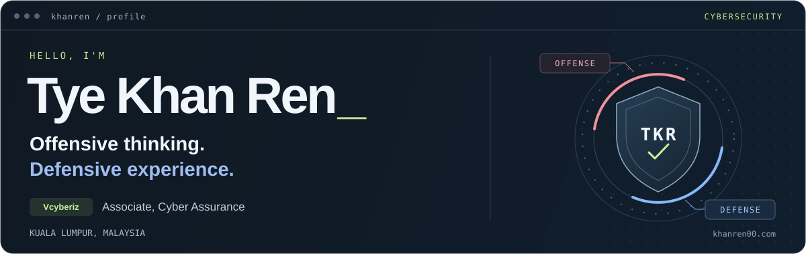

  

<h1 align="center">Tye Khan Ren</h1>

  <strong>Cybersecurity Professional · Cyber Assurance</strong> 
  Kuala Lumpur, Malaysia · VAPT · Threat Detection · Security Operations

  <a href="https://khanren00.com">Portfolio</a> ·
  <a href="https://linkedin.com/in/khan-ren-tye-36a16424b">LinkedIn</a> ·
  <a href="mailto:khanren11@gmail.com">Email</a>

---

## About

I work across offensive and defensive security, helping organizations find weaknesses, improve detection, and strengthen their security operations. I’m currently an **Associate, Cyber Assurance at Vcyberiz**, with previous experience in security operations and incident response.

## Selected projects

- [Distributed YouTube Website](https://github.com/khanren/Distributed_YouTube_Website) — A distributed video streaming platform built with web technologies and Firebase.
- [Anonymous Me](https://github.com/khanren/AnonymousMe) — An Android app for anonymous messaging and social interaction in a student community. *Archived academic project.*
- [One Paradise Massage](https://github.com/khanren/Massage-Web-Assignment) — A massage therapy booking website with appointment scheduling and service management. *Archived academic project.*

## Experience

**Associate, Cyber Assurance · Vcyberiz**  
May 2026–Present

Vulnerability assessment and penetration testing, red teaming, defensive security strategy, and cyber assurance collaboration.

**Cybersecurity Analyst · Delta Spike Asia Sdn Bhd**  
February 2024–April 2026

Security monitoring and incident response across Cortex XDR/XSIAM/XSOAR, Microsoft Defender and Entra ID, CrowdStrike, and Stellar Cyber. Also developed customer-specific use cases, prepared security reports, and led work on a security dashboard.

## Research and education

- **AIURLGuard** — Co-author of *An Intelligent and Explainable AI Framework for Malicious URL Detection*.
- **BSc (Hons), Information Technology (Computer Networking and Security)** — Sunway University, 2024–2026.
- **Diploma in Information Technology** — Sunway College, 2021–2023.

## Security toolkit

**Security platforms:** Cortex XDR · XSIAM · XSOAR · Microsoft Defender · Entra ID · CrowdStrike · Stellar Cyber · Splunk  
**Assessment and systems:** Nessus · Burp Suite · Nmap · Linux

## Certifications

Certified Ethical Hacker (CEH) · Microsoft Certified: Security Operations Analyst Associate · Fortinet Certified Associate Cybersecurity

[View my portfolio and certificates](https://khanren00.com)
