<picture>
  <source media="(max-width: 600px)" srcset="assets/profile-banner-mobile.svg">
  
</picture>

  
  
  
  <a href="https://khanren00.com/Tye_Khan_Ren_CV.pdf">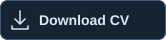</a>

I’m **Khan Ren**, a cybersecurity professional in **Kuala Lumpur**, currently an **Associate, Cyber Assurance at Vcyberiz**. My work brings **VAPT and red teaming** together with **threat intelligence, detection, and incident response**.

My background at Delta Spike Asia includes SOC monitoring, shift leadership, mentoring analysts, and security dashboard development. I also co-authored **AIURLGuard**, research on explainable AI for malicious URL detection.

## Credentials

  <a href="https://khanren00.com/#/certificates">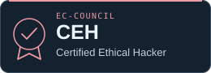</a>
  <a href="https://khanren00.com/#/certificates">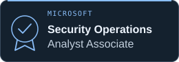</a>
  <a href="https://khanren00.com/#/certificates">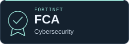</a>

[Explore all certifications →](https://khanren00.com/#/certificates)

## Selected work

<table>
  <tr>
    <td width="50%" valign="top">
      <a href="https://khanren00.com/#/about">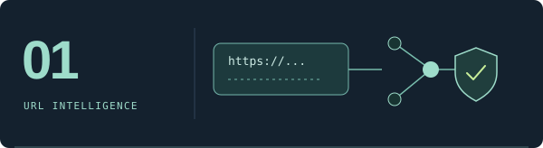</a>
      <h3><a href="https://khanren00.com/#/about">AIURLGuard</a></h3>
      
Co-authored <em>An Intelligent and Explainable AI Framework for Malicious URL Detection</em>.

      
<code>Research</code> <code>Explainable AI</code> <code>URL security</code>

      Research collaboration at Sunway University
    </td>
    <td width="50%" valign="top">
      <a href="https://github.com/khanren/Distributed_YouTube_Website">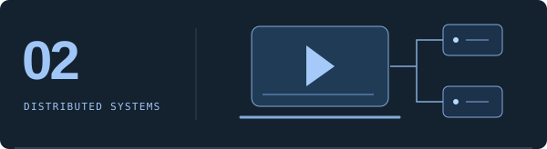</a>
      <h3><a href="https://github.com/khanren/Distributed_YouTube_Website">Distributed YouTube Website</a></h3>
      
A distributed video streaming platform built with web technologies and Firebase.

      
<code>JavaScript</code> <code>Firebase</code> <code>HTML / CSS</code>

      Web development · Academic project
    </td>
  </tr>
  <tr>
    <td width="50%" valign="top">
      <a href="https://github.com/khanren/AnonymousMe">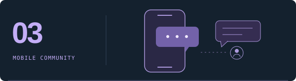</a>
      <h3><a href="https://github.com/khanren/AnonymousMe">Anonymous Me</a></h3>
      
An Android community app for anonymous student posts and discussions.

      
<code>Java</code> <code>Android</code> <code>Firebase</code>

      Archived academic project
    </td>
    <td width="50%" valign="top">
      <a href="https://github.com/khanren/Massage-Web-Assignment">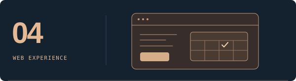</a>
      <h3><a href="https://github.com/khanren/Massage-Web-Assignment">One Paradise Massage</a></h3>
      
A service and appointment website for a massage therapy business.

      
<code>HTML</code> <code>CSS</code> <code>Web design</code>

      Archived academic project
    </td>
  </tr>
</table>

## Tools I work with

**Detection & response**

  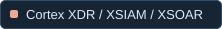
  
  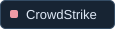
  
  

**Assessment & infrastructure**

  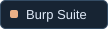
  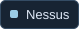
  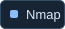
  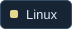
  
  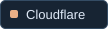
  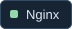

<strong>Career & education</strong> — expand the timeline

### Experience

| Period | Role | Organization |
| :--- | :--- | :--- |
| May 2026–Present | Associate, Cyber Assurance | Vcyberiz |
| Feb 2024–Apr 2026 | Cybersecurity Analyst | Delta Spike Asia Sdn Bhd |
| May 2023–Jan 2024 | Cybersecurity Analyst — Internship & Contract | Delta Spike Asia Sdn Bhd |

At Delta Spike, I worked with Cortex XDR/XSIAM/XSOAR, Microsoft Defender and Entra ID, CrowdStrike, and Stellar Cyber. My responsibilities included customer-specific detection use cases, monthly security reporting, shift leadership, and leading the team developing a security dashboard.

### Education

- **BSc (Hons) Information Technology (Computer Networking and Security)** — Sunway University, January 2024–March 2026.
- **Diploma in Information Technology** — Sunway College, August 2021–August 2023 · CGPA 3.61.

---

Away from the keyboard: travel, music, and a good sci-fi, horror, or action movie.

**Let’s connect:** [Portfolio](https://khanren00.com) · [LinkedIn](https://www.linkedin.com/in/khan-ren-tye-36a16424b/) · [khanren11@gmail.com](mailto:khanren11@gmail.com)
